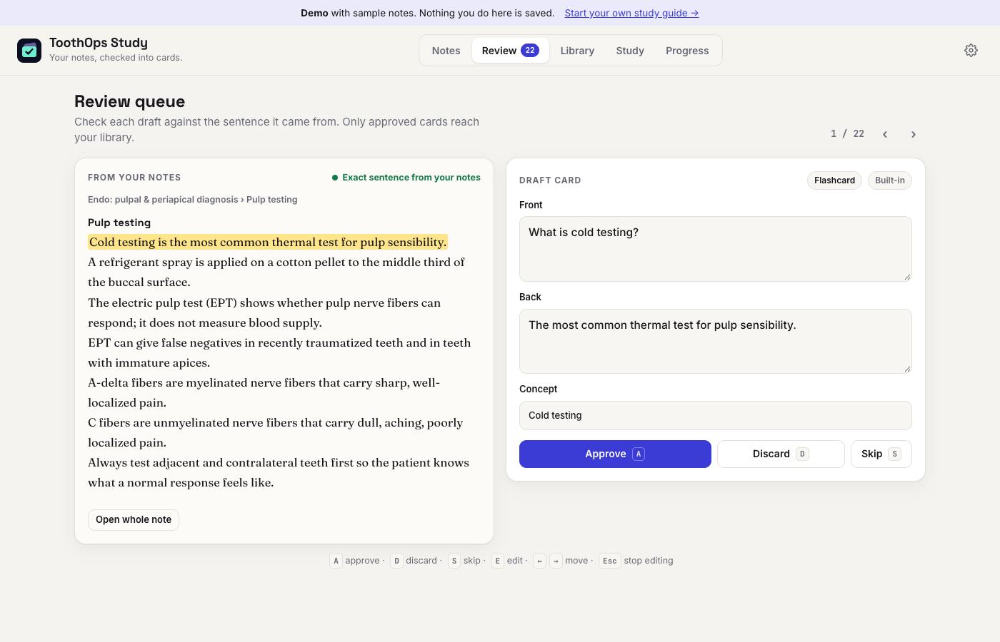
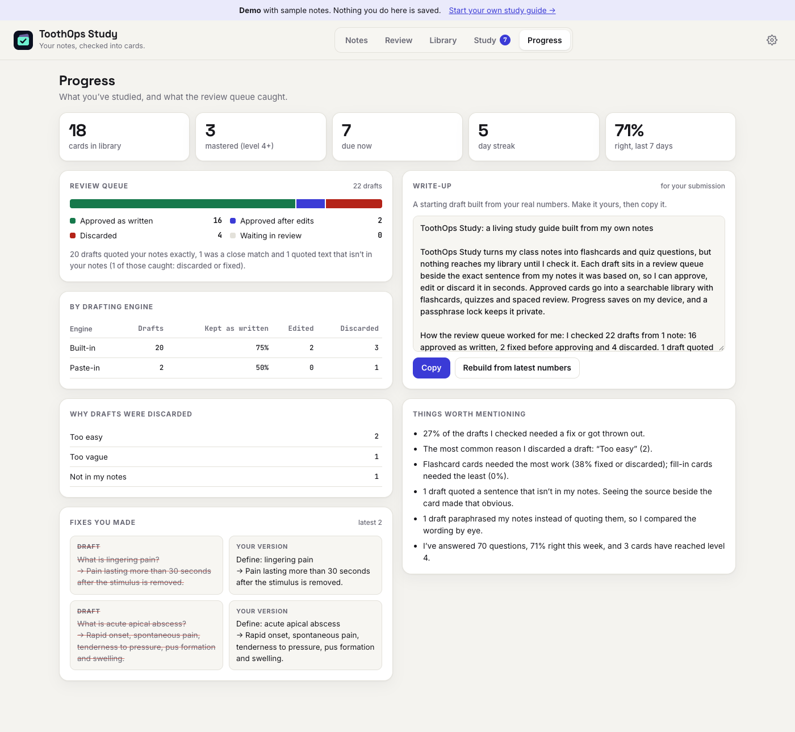

# ToothOps Study

A living study guide built from your own notes. It drafts flashcards and quiz questions from what you give it, and nothing reaches your library until you've checked it against the sentence it came from.

**Live:** https://kristenseog.github.io/toothops-study/
**Demo with sample notes:** https://kristenseog.github.io/toothops-study/?demo=review



## How it works

1. **Pick your source.** Paste notes or upload a `.txt`, `.md`, `.pdf` or `.docx`. Text from a file lands in the editor first so you can trim it before saving.
2. **Draft cards.** Choose a drafting engine:
   - **Built-in.** Runs in the browser with no key. It finds definitions (`Term: meaning`, `X is a…`), lists, numbers and key terms, and builds flashcards, fill-in-the-blanks and multiple-choice questions. Wrong answers come from related terms in the same note.
   - **Claude, Gemini or OpenAI.** Uses your own API key. Your browser sends the note straight to that provider.
   - **Paste-in.** Copies a ready-made prompt for any chatbot. You paste its JSON reply back in, so no key is needed.
3. **Check every card.** Each draft opens in the review queue next to its source sentence, highlighted in the note. Approve it, fix it or discard it with a reason. Keyboard: `A` approve, `D` discard, `S` skip, `E` edit.
4. **Study.** A searchable library, flashcards with self-rating, and quizzes with four choices. Spaced review brings cards back after 1, 3, 7, 16 and 35 days.
5. **Lock it.** Turn on a passphrase and your notes, cards and saved keys are encrypted on this device.

## The review queue

The queue matters most when an AI writes the drafts. Every AI card has to quote the sentence it came from, and the app looks for that sentence in your note:

| Badge | Meaning |
|---|---|
| **Exact sentence** | The quote is in your notes word for word. |
| **Close match** | The wording differs. The closest sentence is highlighted, so compare the two. |
| **Not found in your notes** | Nothing in the note backs the card. You get a red warning, and approving it takes a second confirmation. |

The queue also points out words in the answer that don't appear in the excerpt. The Progress tab counts what you approved, edited and discarded, breaks that down by engine and card type, shows your edits side by side, and starts a write-up using your own numbers.



## Privacy

- Everything is stored in your browser (`localStorage`). There's no server and no account.
- With the lock on, data is encrypted with AES-256-GCM using a key derived from your passphrase (PBKDF2-SHA-256, 310,000 iterations). It auto-locks after a set idle time. There's no way to recover a forgotten passphrase, so download a backup first.
- API keys stay in the browser session unless you choose to remember them. Remembered keys are encrypted when the lock is on.
- To move to another browser or device, use **Settings → Download backup** and then **Restore backup**. You can also export your cards as CSV or as an Anki import file.

## Run it

It's one file. Open `index.html`, or serve the folder:

```sh
python3 -m http.server 8000
```

Open `?demo=notes`, `?demo=review`, `?demo=library`, `?demo=study` or `?demo=progress` to load the sample notes without saving anything. The sample is in [`samples/endo-diagnosis-notes.md`](samples/endo-diagnosis-notes.md).
